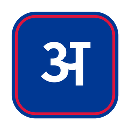
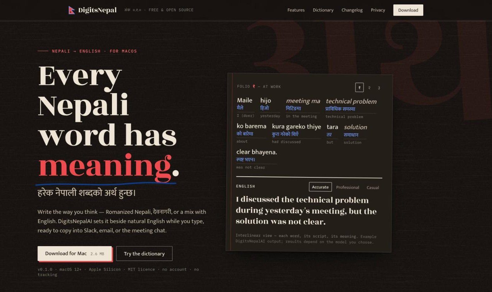

<div align="center">



# DigitsNepal

**Nepali → English writing assistant for macOS, powered by DigitsNepalAI.**

Type in Romanized Nepali, Devanagari, or a mix with English, and get natural English as you write.

[Website](https://digitsnepal.com) · [Download](https://digitsnepal.com/download) · [Dictionary](https://digitsnepal.com/dictionary) · [Changelog](https://digitsnepal.com/changelog)

[](https://github.com/Bhaktabahadurthapa/DigitsNepal/releases/latest)
[](https://github.com/Bhaktabahadurthapa/DigitsNepal/actions/workflows/ci.yml)
[](https://digitsnepal.com/download)
[](LICENSE)

<br>



</div>

## Overview

```text
Maile hijo meeting ma technical problem ko barema kura gareko thiye tara solution clear bhayena.
→ I discussed the technical problem during yesterday's meeting, but the solution was not clear.
```

DigitsNepal keeps the meaning, tense, negation and tone of what you wrote. The faithful translation always sits beside a polished version, and technical terms like *Kubernetes*, *AWS* or *pods* pass through unchanged.

## Features

- **Live translation:** English updates as you type, with no button to press.
- **Works in any app:** select text and press <kbd>⌃</kbd><kbd>⌥</kbd><kbd>T</kbd> to translate, copy, or replace it in place, with undo.
- **Word Meaning Explorer:** contextual and literal meaning, Devanagari spelling, and ambiguity notes for every word and phrase.
- **Six modes:** Accurate, Professional, Casual, Academic, Technical, and Grammar Correction.
- **Meeting overlay:** a compact, translucent, always-on-top window that can be hidden from screen sharing.
- **Model of your choice:** DigitsNepalAI runs locally with Ollama or LM Studio, or with your own key for Claude, Gemini, OpenAI, OpenRouter, Groq, Mistral, DeepSeek, Together, xAI, or any OpenAI-compatible server.

## Installation

Download the latest `.dmg` from [digitsnepal.com/download](https://digitsnepal.com/download) or [GitHub Releases](https://github.com/Bhaktabahadurthapa/DigitsNepal/releases/latest).

1. Open the disk image and drag **DigitsNepal** to **Applications**.
2. On first launch, right-click the app and choose **Open**. Releases are not yet notarized.
3. In **Settings**, choose the model that powers DigitsNepalAI.
4. To use the shortcut in other apps, allow DigitsNepal under **System Settings › Privacy & Security › Accessibility**.

**Requirements:** macOS 12 or later. Prebuilt releases are for Apple Silicon; on Intel Macs, [build from source](#building-from-source).

## Privacy

- No account, analytics, or telemetry.
- Local inference by default. Cloud providers are used only after you enable them, one provider at a time.
- API keys are stored in the macOS Keychain.
- Text is read only when you type into DigitsNepal or explicitly send a selection. Password fields are never read.

See [Privacy](docs/PRIVACY.md) and [Security](SECURITY.md) for details.

## Building from source

**Prerequisites:** Xcode Command Line Tools, [Rust](https://rustup.rs), and Node.js 20+.

```bash
git clone https://github.com/Bhaktabahadurthapa/DigitsNepal.git
cd DigitsNepal
npm install
npm run app:dev      # run in development
npm run app:build    # build DigitsNepal.app and .dmg
npm run check        # typecheck, tests, lint
```

## Built with

[Tauri 2](https://tauri.app) · Rust · React · TypeScript · Tailwind CSS

| Directory | Contents |
|---|---|
| `src-tauri/src/translation` | DigitsNepalAI engine: providers, prompts, response validation, language detection |
| `src-tauri/src/accessibility` | Selected-text capture and replacement via macOS Accessibility |
| `src` | Desktop interface |
| `tests/fixtures` | Nepali–English evaluation set (111 cases) |
| `website` | Source for digitsnepal.com |

## Documentation

[Architecture](docs/ARCHITECTURE.md) · [Evaluation](docs/EVALUATION.md) · [Release process](docs/RELEASE.md) · [Changelog](CHANGELOG.md)

## Contributing

Contributions are welcome, especially dictionary entries, evaluation sentences, and app compatibility reports. Please read [CONTRIBUTING.md](CONTRIBUTING.md) first.

## License

[MIT](LICENSE) © DigitsNepal contributors
